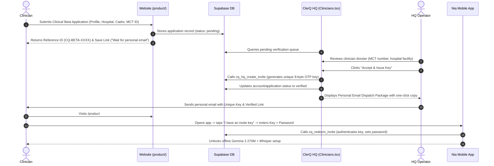

# ClerQ Intelligence — Website & Product Stall Handoff Brief

> **Repository:** `ClerQ-Intelligence-CQ/temp` (Public Staging & Design Handoff)  
> **Target Production Domain:** `https://clerqintelligence.site`  
> **Operating Company:** ClerQ Intelligence (CQ)  
> **Flagship Product:** Nia (ClerQ CDS v1.47.2, baseline build v1.36.0, build `1360`, package `com.ncq.nia.baseline`)  
> **Engineering Partner:** Nama Labs  

---

## 1. Why This Repo Exists & What Went Wrong Previously

This repository contains the complete website source code, design assets, and page implementations for **ClerQ Intelligence**. It has been created so another agent or engineer can pick up the work and execute the vision with total clarity and zero regressions.

### Critical Feedback & Strict User Rules:
1. **Dominant Theme MUST BE PURE WHITE, NOT DARK:**
   - The user explicitly corrected: *"the dominant theme is white not dark brooo"*.
   - Do **NOT** invert the website into dark mode.
   - Aesthetic is **Ramsian high-key minimalism**: pure white `#FFFFFF` and subtle off-white `#F8F9FA` backgrounds, hairline borders (`#E5E5E5`), crisp black typography (`#0A0A0A`), muted captions (`#6B6B6B`), and technical accents (`#00D09C` teal, `#0EA5E9` cyan).
2. **ZERO EMOJIS ANYWHERE:**
   - No emojis in UI buttons, headings, text, or metadata. Use clean vector icons (Lucide/SVG) or geometric symbols.
3. **ABSOLUTELY NO HARDCODED STUBS OR FAKE MOCK DATA:**
   - Never insert fake patient cases, fabricated telemetry numbers (e.g. `48`, `3,840`), or mock arrays. Use genuine database rows or authentic, clean empty states (`0 events recorded`, `Queue clear`).
4. **FAVICON IN CIRCLE FRAME ON BROWSER TABS:**
   - Browser tabs must display the **CQ monogram inside a crisp circular frame** (`favicon.svg?v=3`, `favicon.ico`, `favicon-32.png`). Cache-busting query strings are mandatory so browsers do not cache old square icons.
5. **COPYWRITING GUARDRAILS:**
   - Say **"offline-capable"**, NOT "offline-native" or "offline-only".
   - Do not overhype Lucy or clinical AI. Keep claims grounded, clinical, and safe: Nia is an assistive clinical decision guidance tool grounded in the **Tanzania National Standard Treatment Guidelines (STG 2026)**; attending clinicians retain ultimate clinical responsibility.
   - Spotlight the broader company and research pillars (Sema, Rafiki, Hakiki), not just the CDS app.
6. **NEVER GIT COMMIT OR PUSH TO PRODUCTION REPOS UNLESS EXPLICITLY COMMANDED:**
   - In production repos (`website`, `nia`), keep changes in working tree for user review. In this staging repo (`temp`), you may push handoff commits.

---

## 2. Directory Structure & Key Files

```
├── 404.html                     # Custom 404 error page with navigation
├── _redirects                   # Netlify redirect rules
├── netlify.toml                 # Netlify build and header configuration
├── robots.txt / sitemap.xml     # SEO crawlers and indexing
├── index.html                   # Primary Homepage (Hero 3D, Pillars, Horizon, Dispatches)
├── product/
│   └── index.html               # 3D WebGL Product Stall, Beta Intake, Verified Portal
├── blog/
│   └── index.html               # Engineering Dispatches (LinkedIn/Substack-style articles)
├── about/
│   └── index.html               # Company mission, team, and partnership with Nama Labs
├── research/
│   └── index.html               # Sema Swahili NLP, Rafiki, Hakiki, and Benchmark data
├── partners/
│   └── index.html               # Hospital networks, Ministry of Health, research institutions
├── contact/
│   └── index.html               # Direct inquiry form and Dar es Salaam HQ details
├── hq/
│   └── index.html               # Hidden operator doorway to ClerQ HQ Console (port 3000)
├── css/
│   └── main.css                 # Master design system tokens and responsive styles
├── js/
│   ├── main.js                  # Bilingual EN/SW toggle, mobile menu, scroll reveal
│   ├── hero-scene.js            # Three.js geometric wireframe scene for Homepage hero
│   ├── principles-scene.js      # Three.js 3D Horizon solar model for First Principles
│   └── product-scene.js         # Three.js 3D WebGL Product Stall neural lattice
├── assets/
│   ├── favicons/                # Circle-framed CQ favicons (SVG, ICO, 16, 32, 48, 192, 512)
│   ├── logos/                   # Official CQ monogram vectors and ClerQ logotypes
│   └── images/                  # High-resolution clinical and architectural photography
└── docs/                        # Specifications, copy decks, and technical manuscripts
```

---

## 3. Product Page & 3D WebGL Stall Specification

### What the User Wanted:
> *"it will have a product page with crazy webgl animation n elements or 3js to sell our products. this page is a stall that can and will be changeable and catalogued diff by the hq personnel... with a library of elements n wordings n positionings and button for download style... also a beta fx in each prod page where people can signup to beta... each one will get a cq account with dashboard... to get here must onboard be verified and given secret one time key by admin via email"*

### Implementation Details:
1. **Interactive 3D WebGL Viewport (`product-scene.js`):**
   - High-performance Three.js scene showing an on-device clinical neural lattice inside concentric gimbal rings.
   - Mouse-reactive parallax tilt and rotation.
   - **Dynamic Morphing:** Calling `window.updateStall3D(productId)` alters geometry and accent color based on active product:
     - `nia-cds`: Icosahedron neural core + Emerald `#00D09C`
     - `sema-voice`: Torus knot speech waveform + Cyan `#0EA5E9`
     - `rafiki-triage`: Dodecahedron acuity grid + Amber `#D97706`
     - `hakiki-audit`: Crystalline Merkle box + Violet `#8B5CF6`
2. **Multi-Product Stall Switcher:**
   - Tabs at top of stall dynamically update badge, title, model tag, description, capability cards, and CTA button.
3. **Dual Gateways:**
   - **"Apply for Clinical Beta Evaluation"**: Opens the 3-step clinical enrollment modal.
   - **"Have an Activation Key? Continue to Verified Install"**: Portal for approved clinicians who received their personal email key to unlock the signed APK download (`nia-v1.36.0.apk`).

---

## 4. End-to-End Clinical Beta Workflow Specification



---

## 5. Technology Stack & Running Locally

- **HTML5 & Vanilla JavaScript:** High speed, zero client bundle bloat, SEO-first static site.
- **Three.js (r128):** Lightweight WebGL scenes rendered with transparent alpha backgrounds.
- **Typography:** `General Sans` (Fontshare CDN) + `JetBrains Mono` for telemetry and codes.
- **Local Dev Server:**
  ```bash
  cd website/
  python3 -m http.server 8085
  # Open http://localhost:8085/
  ```
- **ClerQ HQ Console:**
  ```bash
  cd project/web/
  npm run dev -- --host 0.0.0.0 --port 3000
  # Open http://localhost:3000/
  ```

---

## 6. Implementation Status & Aesthetic Delegation Scope

### Completed Infrastructure:
1. **Live Database Migration Applied:**
   - Migration `schema/0004_beta_pipeline.sql` is deployed to Supabase project `lfbghuingwmmjrylwmdz`.
   - RPCs `cq_submit_beta_application`, `cq_check_beta_status`, `cq_verify_beta_key`, `cq_hq_list_applications`, and `cq_hq_review_application` are fully active.
2. **Product Page Pipeline Wired:**
   - `product/index.html` submits applications directly to `cq_submit_beta_application`, generates deterministic `CQ-BETA-XXXXXX` references, and produces live save links.
   - The verified portal validates single-use activation keys via `cq_verify_beta_key`.
3. **ClerQ HQ Console Wired:**
   - `project/web/src/pages/Clinicians.tsx` queries the incoming applications queue via `cq_hq_list_applications`, allows operators to review the dossier (MCT number, cadre, facility), and on approval executes `cq_hq_review_application` which issues the cryptographic OTP key and generates the Personal Email Dispatch Package.
4. **Branding & Monogram:**
   - Circular-framed CQ monogram favicon (`favicon.svg?v=3`, `favicon.ico`, PNG variants) deployed across all website pages and web app.

### Scope Delegated to Next Agent:
1. **Visual & Aesthetic Overhaul:**
   - Elevate the visual impression of the website to feel truly world-class, state-of-the-art, and prestigious.
   - Refine typography scale, spacing rhythms, and micro-interactions while strictly honoring the **pure surgical white (`#FFFFFF`)** palette.
   - Polish the 3D WebGL product stall canvas: ensure smooth shader transitions, fluid mouse parallax, and beautiful geometric representations of the 4 clinical products.
2. **Mobile Viewport Optimization:**
   - Verify layout responsiveness on narrow mobile viewports (375px–430px) for the multi-step intake modal, 3D viewport canvas, and horizontal stall tabs.
3. **Bilingual Copy Review:**
   - Audit Swahili clinical copy across all pages to ensure phrasing aligns with authentic East African medical terminology.

