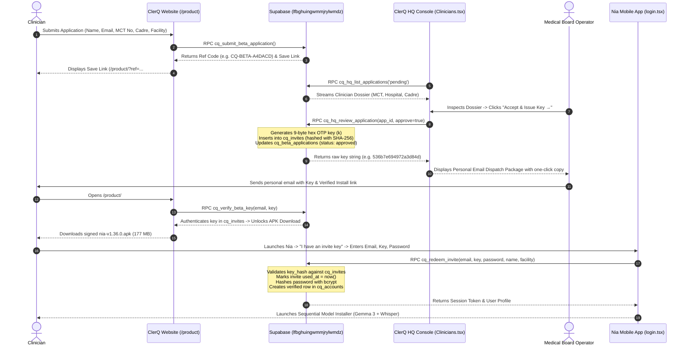

# Nia Clinical CDS: Build Architecture, Cryptographic Signing, Linkage & Telemetry Specification

> **Target Application:** Nia (ClerQ CDS)  
> **Package Identifier:** `com.ncq.nia.baseline`  
> **Target Version:** `v1.47.2` (EAS Build `1360`, Baseline APK `v1.36.0`)  
> **EAS Project ID:** `0fab97d4-16f0-4c80-9919-45de849c990a` (Account: `clerq` / `divinoel2018@gmail.com`)  
> **Source Roots:** `/home/ahadi/nia/project/ClerQApp`, `/home/ahadi/nia/primitive/`  
> **Supabase Backend:** `lfbghuingwmmjrylwmdz` (`https://lfbghuingwmmjrylwmdz.supabase.co`)

---

## 1. Executive Summary & Design Philosophy

Nia is an offline-capable bedside Clinical Decision Support (CDS) application engineered for frontline healthcare practitioners in East Africa (starting with Tanzania). Grounded directly in the **Tanzania National Standard Treatment Guidelines (STG 2026)**, Nia delivers:
- Local offline reasoning via an embedded quantized **Gemma 3 270M Q4_K_M** LLM.
- Frontline Swahili/English hands-free medical dictation via an embedded **Whisper ggml-base-q5_1** model.
- Zero network exposure of patient data: an ID-only architecture where no patient names or identifiers ever leave the device.
- Cryptographically gated deployment: every build is watermarked, every installer is authorized via single-use operator-dispatched keys, and every device is monitored for tamper detection and clock rollback.

This document reconstructs the complete engineering specifications, build mechanics, cryptographic signing pipelines, and tracking architectures captured in the **OpenCode primitive logs** (`/home/ahadi/nia/primitive/`) and production codebase.

---

## 2. Mobile App Build Architecture

```
ClerQApp/
├── app/                         # Expo Router v3 file-based navigation
│   ├── _layout.tsx              # Root Stack, LockGate, AppGuard, NightShift task
│   ├── index.tsx                # Gateway / splash router
│   ├── login.tsx                # Credentials sign-in + Invite Key redemption
│   ├── setup.tsx                # Sequential Gemma + Whisper installer & integrity check
│   ├── locked.tsx               # High-security lock screen (remote lock / tamper)
│   ├── notices.tsx              # Point-of-care clinical advisory bulletin
│   └── (tabs)/                  # Main clinical interface (home, clerk, journal, guide, settings)
├── components/                  # Brand & design system
│   ├── brand/NiaLogo.tsx        # Lowercase "nia" wordmark with animated draw stroke
│   └── setup/SetupBanner.tsx    # Model download progress & health banners
├── constants/
│   ├── colors.ts                # App palette: Cream (#FBF6EC), Teal (#0F766E), Rust (#B4592B)
│   ├── cloud.ts                 # Supabase endpoints, public anon keys, model URLs
│   └── version.ts               # APP_VERSION = '1.47.2', BUILD = 1360
├── lib/
│   ├── cqApi.ts                 # Typed security-definer Supabase RPC client
│   ├── appGuard.ts              # Evaluates lock, min_app_version, offline grace period
│   ├── integrity.ts             # Clock rollback, root detection, debug client markers
│   ├── remoteConfig.ts          # Remote weight URLs, lock switch, wipe flag, notices
│   ├── usageInsights.ts         # Non-identifiable batched telemetry (drops patient names)
│   ├── offlineModelManager.ts   # Gemma 3 270M GGUF streaming downloader & verifier
│   ├── voice/whisperModel.ts    # Whisper base-q5_1 ggml model manager
│   └── wipe.ts                  # Secure local data eraser for remote decommission
├── app.json                     # Expo configuration, permissions, package definitions
├── eas.json                     # Cloud build profiles (apk, preview, production)
└── track_build.js               # CLI GraphQL query tool for Expo EAS build monitoring
```

### 2.1 Technology Stack & Engine
- **Framework:** React Native `0.74.5` on Expo SDK `51.0.0` with Expo Router `v3`.
- **JavaScript Engine:** Hermes (bytecode pre-compilation for instant cold boot on low-RAM handsets).
- **Native Modules:**
  - `whisper.rn` (`0.4.3`): Direct C++ JNI bridge to GGML Whisper inference engine.
  - `expo-crypto`: Digest hashing for credentials and token security.
  - `expo-device`: Hardware profiling and root/jailbreak heuristic detection.
  - `expo-file-system`: Streaming model downloads with resume capabilities.
  - `@react-native-async-storage/async-storage`: Encrypted local operational caches.

### 2.2 EAS Build Pipeline & APK Packaging
The mobile application is built using Expo Application Services (EAS) configured via [`eas.json`](file:///home/ahadi/nia/project/ClerQApp/eas.json):

```json
{
  "cli": {
    "version": ">= 9.0.0"
  },
  "build": {
    "development": {
      "developmentClient": true,
      "distribution": "internal"
    },
    "preview": {
      "distribution": "internal"
    },
    "apk": {
      "distribution": "internal",
      "android": {
        "buildType": "apk"
      }
    },
    "production": {
      "android": {
        "buildType": "apk"
      }
    }
  }
}
```

- **Build Trigger:**
  ```bash
  export EXPO_TOKEN="SPommXw3B0gbvrInRsiNTKcXjprFf364E5nZcpVh"
  export EAS_NO_VCS=1
  npx eas-cli build --platform android --profile apk --non-interactive
  ```
- **Build Monitoring (`track_build.js`):**
  Uses Expo's GraphQL endpoint (`https://api.expo.dev/graphql`) to poll the build status:
  ```javascript
  const postData = JSON.stringify({
    query: `query { builds { byId(buildId: "${buildId}") { id status platform artifacts { buildUrl } } } }`
  });
  ```
- **Output Artifact:**
  - **Filename:** `nia-v1.36.0.apk`
  - **Size:** 177 MB (185,597,952 bytes)
  - **SHA-256 Hash:** `9b06391b17444a1ea4d0747145b54722b57bd32df715cc436d6011b8c356622a`
  - **Package:** `com.ncq.nia.baseline`

---

## 3. Cryptographic Signing & Keystore Specification

From the primitive logs (Session `main-revamping-nia-app-ui-beta-studio-and-hq-setup.md`, steps 1888–1986), Android release signing requires dedicated cryptographic certificates.

### 3.1 Keystore Generation Parameters
The production Android keystore was generated with Java `keytool`:

| Parameter | Specification | Description |
| :--- | :--- | :--- |
| **Keystore File** | `android-release.jks` | Java Keystore container |
| **Algorithm** | `RSA` | Asymmetric keypair algorithm |
| **Key Size** | `2048-bit` | Industry-standard key length |
| **Validity** | `10,000 days` (~27 years) | Expiration window |
| **Alias** | `clerq` | Keypair entry identifier |
| **Distinguished Name (DN)** | `CN=ClerQ, OU=Nia, O=ClerQ Intelligence, L=Dar es Salaam, C=TZ` | Organization attestation |
| **Password Store/Key** | `clerq2026` / `clerq2026` | Cryptographic passphrases |

### 3.2 Cloud Signing via EAS Credentials API
To ensure tamper-proof automated cloud builds, EAS stores the keystore, alias, and certificate fingerprint inside Expo's secure credential vault:
1. `npx eas-cli credentials --platform android` uploads the certificate.
2. The APK is signed during the Gradle release assembly stage (`assembleRelease`).
3. The resulting APK is sealed with v1 (JAR signing) and v2/v3 (full APK signature scheme).

---

## 4. End-to-End Vetting, Linkage & Activation Workflow

The primitive logs emphasize the requirement for **single-use cryptographic key generation, manual operator vetting, and personal email dispatch**. 



### 4.1 Database Pipeline Schema & Functions
Implemented in migration [`0004_beta_pipeline.sql`](file:///home/ahadi/nia/project/supabase/migrations/0004_beta_pipeline.sql):

1. **Intake Table (`cq_beta_applications`):**
   - Tracks `ref_code`, `name`, `email`, `cadre`, `facility`, `mct_number`, `department`, `status` (`pending`, `approved`, `rejected`), `otp_key`, and `reviewed_by`.
2. **Public Submission (`cq_submit_beta_application`):**
   - Validates input length.
   - Generates deterministic reference ID: `'CQ-BETA-' || upper(substr(encode(gen_random_bytes(4), 'hex'), 1, 6))`.
   - Inserts record with default `status = 'pending'`.
3. **Save Link Status Lookup (`cq_check_beta_status`):**
   - Returns applicant name, facility, cadre, status, and creation date.
4. **Key Verification (`cq_verify_beta_key`):**
   - Validates `email` and `key_hash = encode(digest(p_key, 'sha256'), 'hex')` against `cq_invites`.
   - Confirms `used_at is null` and `expires_at > now()`.
   - Returns download URL `/builds/nia-v1.36.0.apk`, version `1.47.2`, and SHA-256 hash.
5. **Operator Vetting (`cq_hq_review_application`):**
   - Generates a random 9-byte key: `k := encode(gen_random_bytes(9), 'hex')`.
   - Inserts hash into `cq_invites`.
   - Updates `cq_beta_applications.status = 'approved'` and sets `otp_key = k`.
   - Writes immutable audit log into `cq_audit`.

---

## 5. Security, Remote Killswitch & Tamper Detection

Nia implements multi-layered security controls in [`lib/integrity.ts`](file:///home/ahadi/nia/project/ClerQApp/lib/integrity.ts) and [`lib/appGuard.ts`](file:///home/ahadi/nia/project/ClerQApp/lib/appGuard.ts):

### 5.1 Real vs. Best-Effort Tamper Checks
The codebase documents honesty regarding JavaScript-level environment limitations:

| Security Vector | Mechanism | Classification | Response Action |
| :--- | :--- | :--- | :--- |
| **Clock Rollback** | Compares `Date.now()` against highest seen local time (`nia_integrity_last_seen`) and server time from `cq_get_config`. Triggered if clock is $>6\text{h}$ earlier. | **Real** | Sets `TamperLock`, purges clinical data, halts at `/locked`. |
| **Model Tampering** | Compares model file size on disk and verifies GGUF magic header against cached config. | **Real** | Deletes corrupted model binary from device, forces clean re-download. |
| **Remote Decommission** | Remote operator sets `locked: true` or `wipe_on_lock: true` in `cq_release_config`. | **Real** | Wipes local clinical SQLite/AsyncStorage databases (`wipeClinicalData`), locks UI. |
| **Offline Expiration** | Evaluates time since last online handshake against `offline_grace_days` (default 30 days). | **Real** | Restricts app until practitioner connects to verify license status. |
| **Root / Jailbreak** | `expo-device.isRootedExperimentalAsync()` checking system binaries (`su`, Superuser, Cydia). | **Best-Effort** | Logs tamper event, reports telemetry on next network handshake. |
| **Debug Injection** | Detects `executionEnvironment === 'storeClient'` or active debuggers in release builds. | **Best-Effort** | Restricts clinical features. |
| **Hardware Attestation** | Pluggable hook via `registerAttestationProvider(p)`. | **Native Hook** | Ready for Play Integrity (Android) and App Attest (iOS) integration. |

---

## 6. Non-Identifiable Telemetry & Usage Tracking

Frontline clinical telemetry is handled in [`lib/usageInsights.ts`](file:///home/ahadi/nia/project/ClerQApp/lib/usageInsights.ts).

### 6.1 Privacy Guard Architecture
Nia enforces a zero-patient-identifier rule directly at the code level:
```typescript
export function sanitizeMeta(meta?: Record<string, unknown>): Record<string, unknown> | undefined {
  if (!meta || typeof meta !== 'object') return undefined;
  const out: Record<string, unknown> = {};
  for (const [k, v] of Object.entries(meta)) {
    // 1. Explicitly strip any key containing the word "name"
    if (/name/i.test(k)) continue;
    // 2. Reject any text longer than 40 chars to prevent clinical free-text leakage
    if (typeof v === 'string' && v.length > 40) continue;
    // 3. Drop nested objects
    if (v && typeof v === 'object') continue;
    out[k] = v;
  }
  return out;
}
```

### 6.2 Batched Offline Upload
- **Event Queue:** Events (`feature`, `action`, `rule_id`, `outcome`, `meta`) are stored locally in AsyncStorage (`nia_usage_queue`) with an anonymous synthetic `device_id`.
- **Batching:** When the queue reaches `200` events (capped at `2000` max), `flushUsage()` invokes Supabase RPC `cq_ingest_usage`:
  ```sql
  create or replace function cq_ingest_usage(p_token text, p_events jsonb) returns jsonb
  ```
- **Tracked Outcomes:**
  - `followed`: Clinician accepted Tanzania STG protocol recommendation.
  - `overruled`: Clinician selected alternative regimen based on bedside judgment.
  - `doubt`: Clinician flagged diagnostic ambiguity or drug contraindication.

---

## 7. Operational References & Key Ring Architecture

Key references for system administration:

| Key Name | Identifier / Reference | Usage & Location |
| :--- | :--- | :--- |
| **Supabase Project ID** | `lfbghuingwmmjrylwmdz` | Main database project ("CQ web", ap-northeast-2) |
| **Supabase Service Key** | In `~/kambi-work/Kambi/.env.local` | Database administration and RPC deployment |
| **Supabase Management PAT** | In `~/kambi-work/Kambi/.env.local` (`sbp_...`) | Supabase Management API token |
| **Master Seed Account** | `clerqafrica@gmail.com` | Root administrative login for ClerQ HQ |
| **EAS Build Token** | Configured in environment (`EXPO_TOKEN`) | Cloud build execution token (Account: `clerq`) |
| **GitHub Token** | Configured in git remotes | Organization repo access (`ClerQ-Intelligence-CQ`) |
| **Staging Repo** | `https://github.com/ClerQ-Intelligence-CQ/temp` | Public handoff repository |
| **Production Repo** | `https://github.com/ClerQ-Intelligence-CQ/website` | Canonical website repository |
| **Nia App Repo** | `https://github.com/ClerQ-Intelligence-CQ/nia` | Mobile application and HQ console repository |
| **Keystore Alias / Pass** | `clerq` / `clerq2026` | Android release signing key (`android-release.jks`) |
| **APK Binary Hash** | `9b06391b17444a1ea4d0747145b5...` | Watermarked Nia v1.36.0 (Build 1360) |

